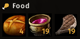
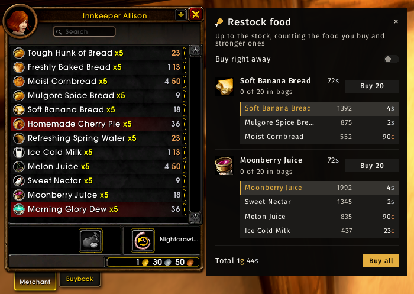
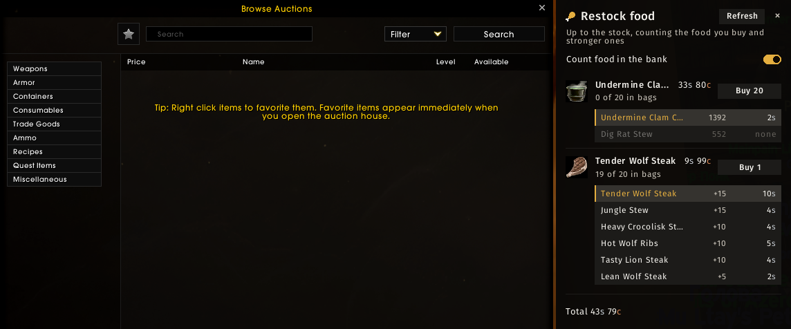
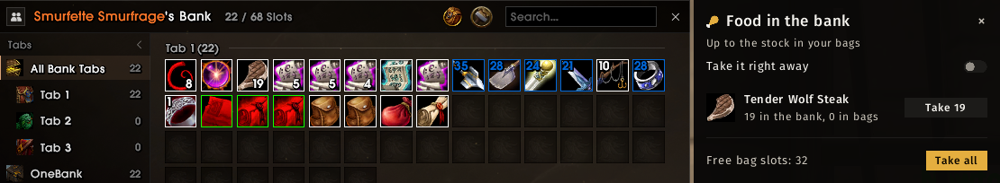

# ReFood: Food & Water Restock

Keeps your food and drinks in one place in WoW Forever: one button that eats the strongest food you have, one that drinks, a Well Fed button with a reminder, keys and action bar macros that do the same, and panels that restock food at the vendor, the auction house and the bank.

## The panel

A small panel with a food button, a drink button for classes with mana and a Well Fed button. Each button shows what it will eat or drink and how much you keep (amber below your stock, red at 0).

A click eats the strongest food in your bags that your level allows. Hover a button for the full list of food in your bags.

- Mage food and water go first, so they are used up before they vanish when you log out for a while. Conjured food below the skip threshold (see below) waits until nothing else is left. You can switch this off.
- At the same strength the button picks plain food over buff food, so a Homemade Cherry Pie goes before Smoked Desert Dumplings.
- Food that restores a share of your health, like Restorative Bread, counts by what it gives you now: 100% of 4000 health is 4000.

The count is your stock: the food you buy and stronger ones. By default that is the strongest food the vendors sell for your level. With 8 Homemade Cherry Pie and 12 Mutton Chop the button shows 8 in amber, and the vendor offers 12 more pies. Weaker food doesn't count, but it is eaten when nothing stronger is left.

Turn on the **Food and drink** button on the Food tab to eat and drink with one click. Its icon shows both halves.

You can't eat in combat, and the game doesn't let addons change buttons mid-fight, so the buttons switch to new food after the fight.

The panel shows always (the default), only in combat, or never. Drag the title line above the buttons or Alt-drag a button to move the panel, middle-click to put it back, right-click for the settings.

## Well Fed

Most cooked food in Forever makes you Well Fed for 15 minutes after 10 seconds of eating. Pick your buff on the Food tab: Strength, Stamina, Spirit, Attack Power, Spell Damage and so on, 15 in all. Only buffs you can get at your level are listed.

- The Well Fed button eats the strongest food with your buff. A rogue who picked Agility eats Swiftstrike Steak at 45.
- The food and drink buttons leave the food with your buff alone, so you don't eat your raid food after a pull.
- The button dims while you are Well Fed and shows the time left for the last 3 minutes (adjustable, 0 turns it off).
- The stock (5 by default, adjustable) is restocked at the vendor, the auction house and the bank like your other food.

Without a picked buff the button eats any buff food you carry, the one for the highest level first, and nothing is restocked.

## Keys and macros

- Bind a key to each button on the Food tab or in the game's key bindings.
- Drag a button from the panel onto an action bar and you get a macro (ReFood Food, ReFood Drink, ReFood Rest, ReFood Buff) that follows every choice the addon makes and shows the food, its count and cooldown like a normal action button. The Food tab has buttons that pick up the same macros.

The macros are made per character when you first drag them. If all 30 character macro slots are taken, an account macro is used.

## Vendor

When you talk to a vendor who sells food or drinks, a panel next to the window lists what you are short of, up to the stock you keep (20 food and 20 drinks by default, adjustable). Food in the bank counts toward it; switch off "Count food in the bank" on the panel or on the Vendor tab to buy the full stock for your bags.

- The strongest food the vendor sells for your level is chosen. Innkeepers sell several drinks: under the row each one is listed with how much it restores and its price; click another one to buy it instead. Your pick is remembered, and the stock then counts that food and stronger ones.
- Food that restores less than 20% of your max health or mana (adjustable) isn't offered. A level 60 warrior with 4000 health sees Homemade Cherry Pie, not Mutton Chop.
- **Buy all** buys every row, one stack at a time. If you can't pay for all of it, the row says how many you can pay for. Turn on "Buy right away" to skip the click.

## Auction house

The auction house panel is for cooked food: plain food other players cook and the food with your Well Fed buff. It lists what you are short of with the cheapest price.

- The strongest food on sale is chosen by default, the rest is listed under the row with its price; click one to buy it instead.
- **Price jump guard.** A purchase takes only food priced at most 20% (adjustable) above the cheapest one. If 4 cost 15s and the fifth costs 1g, the panel buys 4 and tells you the rest is dearer.
- Purchases from the auction house arrive by mail and count toward the stock while they wait in the mailbox.

## Bank

When you open the bank, a panel next to it lists the food your bags are short of. **Take all** moves the food the stock counts into your bags, the strongest first, splitting stacks so you get exactly the stock. Turn on "Take it right away" to skip the click.

All three panels sit to the right of their window and follow it, also when a bag addon replaces the bank window. They share the space with the panels of ReScroll and RePotion. On the Vendor, Auction and Bank tabs you can attach the panel to the window or to another addon's panel, to the right, left, below or above. Drag a panel to move it; right-click it to open its settings, middle-click to put it back.

## Settings

`/food` (or `/refood`) opens the settings:

- **Food:** which buttons to show on this character, their keys, the skip threshold, how much to keep, mage food first, the Well Fed buff and its reminder, the macros
- **Panel:** when it shows up, food you are out of, icon size, spacing, row or column, the title line, the count, lock, the background of the panel and of the vendor, auction and bank panels, minimap button, language
- **Vendor:** the vendor list, buying right away, counting the bank, where the panel sits
- **Auction:** the auction house list, the price jump guard, where the panel sits
- **Bank:** the bank panel, taking food right away, where the panel sits

## Other Re addons

Panels like this one for the other things you carry, with the same restock at the auction house and the bank:

- [ReScroll](https://www.curseforge.com/projects/1812247) shows which scroll buffs you are missing, applies them with one button and restocks scrolls ([GitHub](https://github.com/Jagerente/ReScroll)).
- [RePotion](https://www.curseforge.com/projects/1815534) gives you one button for health potions and one for mana potions, and restocks them ([GitHub](https://github.com/Jagerente/RePotion)).
